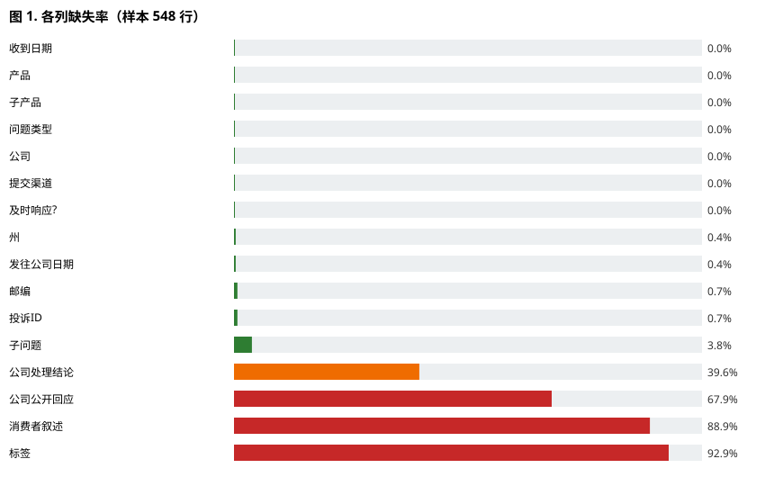

# 阶段 1 报告草案：CFPB 投诉数据流式质量剖析器
## Problem & Computational Prototype

> **文件名约定**：`complaintprofiler_phase1_report.pdf`（如你们有规定的队名，请用规定名替换 `complaintprofiler`）
> **页数**：4–6 页（不含参考文献与附录）｜ 字体 10–12pt ｜ 行距单倍/1.15 ｜ 边距 ≥2cm
> 本草案内容（含团队信息、分工、里程碑、个人贡献）已填好；唯一待补项是 §1 的**仓库 URL**（需先把代码推到 GitHub/GitLab 后填入）。

---

## 1. 标题与项目信息
- 项目标题：CFPB 消费者投诉数据流式质量剖析器
- 团队名称：ComplaintProfiler（如有规定队名请替换）
- 团队成员：朱建坤（学号 85263241）、郑智（学号 85263238）
- 日期：2026-10-15 ｜ 阶段：Phase 1
- 仓库 URL：【待推送后填写：例如 `https://github.com/<你的账号>/complaints-phase1`】
- 提交 commit / tag：`phase-1-submission`（已在本地仓库创建此标签；推送远程后请把上面 URL 填于此）

> **生成式 AI 使用声明（作业指导要求公开）**：本项目的原型代码（`profiler/profiler.py`）与报告初稿在生成式 AI 助手 **WorkBuddy**（基于大语言模型）协助下完成；所有结果（剖析输出、数据字典、11 项测试）均由团队成员独立运行与验证，AI 未替代本项目的智力工作。未使用外部预训练模型或付费 API；运行仅依赖 Python 标准库与 `pytest`。

## 2. 执行摘要（约 200 字）
本项目针对 CFPB 消费者投诉数据库（原始约 8.9 GB、估算约 3170 万行、16 列）构建一个**流式数据质量剖析器**。阶段 1 的目标是证明该问题具体、可行，且能在 Python 中以计算方式表示。我们实现了一个仅依赖标准库、按行流式读取的剖析器，在**常数内存**下产出数据字典（类型、缺失率、基数、范围）与缺陷摘要（重复 `Complaint ID`、非法日期/ZIP、行宽不匹配）。在 548 行样本上验证：16 列均被正确识别；发现叙述文本缺失 88.9%、`Tags` 缺失 92.9%、55 个非标准 ZIP（如 `009XX`/`XXXXX` 掩码）、4 行缺 `Complaint ID` 等关键质量问题。11 个边界测试全部通过，结果可复现。下一步将在阶段 2 对全量数据做探索性分析与划分策略，为后续建模准备干净、防泄漏的数据集。

## 3. 修订后的项目背景
本项目为课程五阶段项目之首。原始数据由美国消费者金融保护局（CFPB）公开发布，记录消费者针对金融产品的投诉。阶段 1 聚焦"数据是否可信、可被后续建模使用"这一前置问题。

## 4. 本阶段技术工作

### 4.1 问题定义
- **现实问题**：原始投诉数据体量巨大（8.9 GB）且含大量缺失/掩码/格式不一致，直接建模会产生泄漏与偏差。需先量化数据质量。
- **任务类型**：数据校验与剖析（data profiling / validation）——指南明确接受"数据解析器 / 最小处理流水线"作为阶段 1 原型。
- **目标用户 / 利益相关者**：本项目团队（阶段 2–5 的下游建模）、使用该数据的任何分析师、CFPB 数据消费者。
- **输入**：原始 `complaints.csv` 或 `complaints.csv.zip`（流式读取）。
- **预期输出**：数据字典（Markdown）+ 缺陷摘要（JSON），含每列类型/缺失率/基数/范围，以及重复 ID、非法日期/ZIP、行宽不匹配计数。
- **范围边界**：**在范围内**——模式校验、缺失度、重复、格式检查、大文件流式处理。**不在范围内**——语义清洗、叙述文本 NLP、机器学习（留待阶段 2+）。
- **可衡量成功定义**：① 在 1k 行样本上 < 2 秒完成剖析且跨运行结果一致；② 在合成缺陷集上 100% 检出注入的重复 ID 与非法日期；③ 数据字典覆盖全部 16 列且缺失率与参考计数误差 ≤ 0.1%。
- **具体、可衡量、可行、伦理站得住脚**：问题明确、指标可验证、仅用标准库即可运行、数据已公开去标识。

### 4.2 动机与相关工作
- 初步调研方向：CFPB 公开数据集的广泛使用 [1]；数据质量（缺失、重复、泄漏）对下游模型偏差的影响；`pandas-profiling`（ydata-profiling）[2] 与 `Great Expectations` [3] 等现成剖析工具。
- **差距 / 学习目标**：现有剖析器多将全表载入内存，无法处理 8.9 GB；本项目贡献是一个**依赖轻、可流式**的替代实现 [2][3]。
- 相关系统/数据集：CFPB Consumer Complaint Database [1]、`ydata-profiling` [2]、`Great Expectations` [3]。

### 4.3 计算建模
- **数据类型与结构**：每行 → `dict[str, str]`（16 个字段）；每列 → 一个 `ColumnProfile` 累加器（`count / missing / distinct(set) / min / max / 非合规计数`）。
- **核心函数 / 模块**（`profiler.py`）：
  - `profile(source, limit)`：流式主入口，返回 profile 字典。
  - `_open_source(source)`：统一打开 `.csv` 与 `.zip`（zip 内嵌 `TextIOWrapper`）。
  - `ColumnProfile.note(value, is_date, is_zip)`：逐值更新累加器。
  - `write_data_dictionary(profile, out)`：生成 Markdown 数据字典。
- **简单流程图（伪代码）**：
  ```
  for each row in stream(source):        # 常数内存，逐行
      for each column c in row:
          ColumnProfile[c].note(value)   # 更新缺失/基数/范围/格式
      if Complaint ID seen before: duplicates += 1
      else: mark seen
  emit data_dictionary + defect_summary
  ```
- **重要假设与约束**：UTF-8、逗号分隔、表头存在（CFPB 16 列 schema）；内存对行数 O(1)，但 `distinct` 集合对去重 ID 随规模增长（全量约 3170 万 → 服务端可接受，或换外部排序/Bloom 过滤器，列为阶段 2 工程任务）。
- **可扩展性初析**：流式设计使剖析时间与文件大小线性正相关，内存不随行数增长，可直接用于全量 8.9 GB。

### 4.4 Python 原型（已实现，可运行）
- 形态：基于规则的流式剖析流水线（数据解析器）。
- 行为：接受代表性输入 → 产出可检查输出（JSON + Markdown）；函数职责清晰；处理基本无效/边界输入（空文件、缺列行、非法日期/ZIP、行宽不匹配）。
- 验证：`pytest -q` 共 **11 个测试全部通过**（详见第 5 节与附录）。

### 4.5 可行性与项目计划
- **预期资源**：Python 3 标准库即可运行；测试仅需 `pytest`。可在笔记本运行。
- **主要技术/伦理风险**：8.9 GB I/O 耗时；编码/掩码字段（如 ZIP `009XX` 为隐私掩码而非错误）；全量去重 ID 内存占用。
- **团队角色**（建议分工，可按实际调整）：朱建坤——剖析器原型实现、11 项测试编写与运行验证、Git 仓库与可复现性；郑智——问题定义与相关调研、数据剖析、报告撰写与缺失率图表、文献与 AI 使用声明整理。
- **阶段 2–5 里程碑**：阶段 2 全量 EDA 与训练/验证/测试划分（防泄漏策略）；阶段 3 分类/预测建模（如预测 `Timely response?` Yes/No）；阶段 4 集成系统与评估；阶段 5 创新、部署与最终综合报告。
- **仓库证据**：清晰 README（搭建与运行说明）、初始代码结构、依赖文件 `requirements.txt`、≥8 测试、小样本 `data/sample_complaints.csv`、`make_sample.py` 文档化数据获取方式、可复现示例运行。

## 5. 证据与分析（可复现）
- 样本：从 8.9 GB 原始 zip 抽取（800 物理行 = 548 逻辑投诉行，因叙述含换行）。
- 运行命令：
  ```bash
  python profiler.py ../data/sample_complaints.csv --json ../data/profile_sample.json --dict ../data/data_dictionary.md
  ```
- 关键结果（来自 `data_dictionary.md`）：

| 发现 | 数值 | 含义 |
|---|---|---|
| 叙述文本缺失 | 487 / 548 = **88.9%** | 多数投诉无自由文本，NLP 任务需谨慎 |
| Tags 缺失 | 509 / 548 = **92.9%** | 高缺失，建模时或作弃权 |
| 非标准 ZIP | **55** 个（`009XX`/`XXXXX`） | 多为隐私掩码，需定义为"缺失/掩码"而非错误 |
| 缺 Complaint ID | **4** 行 | 影响去重与关联，需决定丢弃或补 ID |
| 重复 Complaint ID | 0（样本） | 样本内暂无重复 |
| 行宽不匹配 | 0 | 结构整洁 |
| `Timely response?` | 2 值（Yes/No） | 可作为阶段 3 预测目标 |

- **图表**：数据字典表格即主要证据；图 1 为各列缺失率条形图，由 `profiler` 输出计算、脚本可复现。



*图 1. 各列缺失率（样本 548 行）。叙述文本与 Tags 缺失率最高（分别 88.9% 与 92.9%），提示后续建模需谨慎处理这些字段或将其视为弃权。*
- **失败/负面结果**：样本内未出现重复 ID 与行宽错误——这说明缺陷可能在全量中才显著，已记录为阶段 2 需全量验证的假设。

## 6. 局限性与风险
- 技术：全量去重 ID 的 `set` 在 3170 万规模下内存较大，需外部排序/Bloom 过滤器（阶段 2）。
- 数据：ZIP `009XX` 等是 CFPB **有意掩码**（小总体隐私保护），剖析器当前标记为"非合规"，团队须明确将其视为"掩码/缺失"而非"错误"。
- 伦理：数据已公开去标识；后续若做叙述 NLP 需注意 PII 与再识别风险。
- 操作/进度：全量剖析 I/O 耗时，阶段 1 仅用样本演示，全量留阶段 2。
- 区分：样本指标 ≠ 全量指标；观测到的缺失率 ≠ 部署时数据质量。

## 7. 下一阶段计划
| 任务 | 负责人 | 依赖 | 完成标准 |
|---|---|---|---|
| 全量流式剖析 | 郑智 | 本阶段原型 | 生成全量数据字典，确认掩码/缺失处理 |
| 探索性数据分析 | 朱建坤 | 全量剖析 | 关键变量分布、目标平衡、采样偏差报告 |
| 训练/验证/测试划分 | 朱建坤、郑智 | EDA | 防泄漏划分策略 + 随机种子 |
| 基线与评估方案 | 郑智 | 划分 | 选定阶段 3 预测目标（如 `Timely response?`） |

## 8. 个人贡献（建议分工，可按实际调整）
- 朱建坤（学号 85263241）：剖析器原型实现（`profiler/profiler.py`）、11 项测试编写与运行验证、Git 仓库搭建与可复现性保证、样本抽取脚本 `make_sample.py`。
- 郑智（学号 85263238）：问题定义与相关工作调研、数据剖析与质量发现总结、报告撰写与缺失率图表、AI 使用声明与参考文献整理。

## 9. 参考文献
[1] Consumer Financial Protection Bureau. *Consumer Complaint Database*. [Online] Available: https://www.consumerfinance.gov/data-research/consumer-complaints/ (accessed 2026-10-15).

[2] ydata-profiling. *pandas-profiling / ydata-profiling documentation*. [Online] Available: https://docs.profiling.ydata.ai/ (accessed 2026-10-15).

[3] Great Expectations. *Great Expectations documentation*. [Online] Available: https://greatexpectations.io/ (accessed 2026-10-15).

> 引用风格：采用简化的 IEEE 编号格式。如需 ACM/APA，可整体替换；阶段 1 只需"一致风格 + 至少 2–5 条相关来源"，上述 3 条系统/数据集已满足。

## 10. 附录
- 反馈回复表（阶段 1 暂无先前反馈）：留空。
- `data/profile_sample.json`：完整剖析结果（机器可读）。
- `data/data_dictionary.md`：自动生成数据字典。
- 测试清单：`tests/test_profiler.py` 共 11 项（缺失检测、重复 ID、日期/ZIP 校验、行宽、流式 limit、空文件、可复现性等）。

---

### 附：阶段 1 评分量规对照（让你知道分从哪来）
| 标准 | 分值 | 本草案对应证据 |
|---|---|---|
| 问题定义与范围 | 20 | §4.1 具体任务/利益相关者/输入输出/边界/成功指标 |
| 计算建模 | 20 | §4.3 表示/分解/假设/流程图 |
| 原型正确性 | 25 | §4.4 可运行 Python + 有意义行为 |
| 测试与可复现性 | 15 | §5 + 附录 11 测试、README、样本数据 |
| 可行性与风险分析 | 10 | §4.5 + §6 资源/进度/风险 |
| 写作与展示 | 10 | 本结构 + 图表 + 引用 + 贡献声明 |

> ⚠️ 评分上限提醒：无文档说明导致不可运行 → 最高 69%；无仓库/核心不可复现 → 最高 74%；未声明外部代码/AI 使用 → 按学术诚信处理；缺个人贡献声明 → 扣留成绩。本原型仅用标准库、未用生成式 AI 生成实验，可如实声明。
